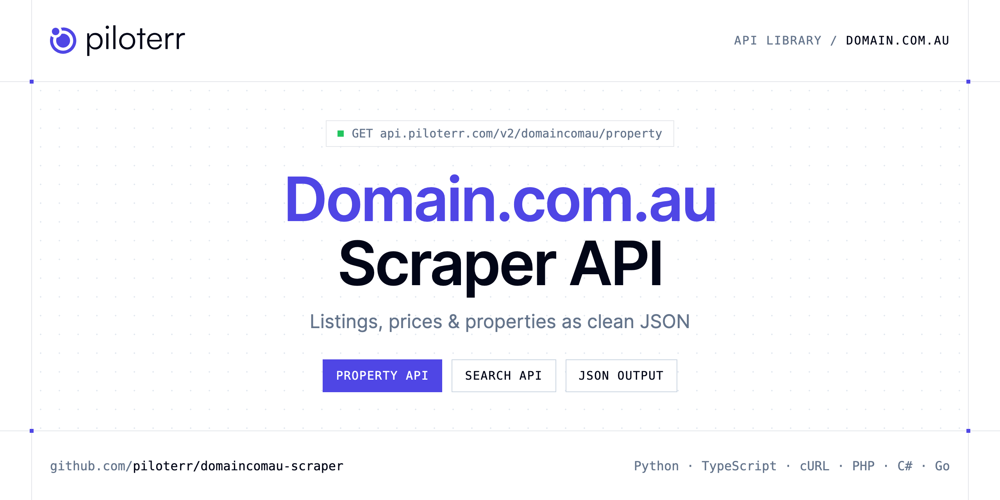

<p align="center">
  <a href="https://www.piloterr.com"></a>
</p>

# Domain.com.au Scraper API

[](https://discord.gg/CFj3ph8aHU) [](https://app.piloterr.com) [](https://app.piloterr.com/openapi) [](LICENSE)

The **Piloterr Domain.com.au Scraper API** lets you extract public data from Domain.com.au as **clean, structured JSON** — no proxies, headless browsers or HTML parsing to maintain. Endpoints available in production:

- **Domain.com.au Property API** — Read one Domain.com.au listing from its URL.
- **Domain.com.au Search API** — Search Domain.com.au by suburb.

Use it for property price monitoring, market analytics, investment sourcing or rental yield models.

| Endpoint | Path | Credits | What you get |
|---|---|---|---|
| [Domain.com.au Property API](#domaincomau-property-api) | `/v2/domaincomau/property` | 2 | Read one Domain.com.au listing from its URL. The response is a flat object with price, address, agency, and photos. |
| [Domain.com.au Search API](#domaincomau-search-api) | `/v2/domaincomau/search` | 2 | Search Domain.com.au by suburb. mode is sale, rent, or sold. page starts at 1. Each card has a dollar price and a price label rebuilt from that amount. |

## Table of contents

- [How it works](#how-it-works)
- [Domain.com.au Property API](#domaincomau-property-api)
- [Domain.com.au Search API](#domaincomau-search-api)
- [Code examples in other languages](#code-examples-in-other-languages)
- [Practical use cases](#practical-use-cases)
- [Why Piloterr?](#why-piloterr)
- [FAQ](#faq)
- [Related scrapers](#related-scrapers)
- [Support](#support)

## How it works

1. **Create a free Piloterr account** and copy your API key from the [dashboard](https://app.piloterr.com).
2. **Send a `GET` (or `POST`) request** to `https://api.piloterr.com/v2/...` with the header `x-api-key: YOUR_API_KEY`.
3. **Receive structured JSON** — Piloterr handles rendering, proxies, retries and parsing.

```bash
export PILOTERR_API_KEY="your-api-key"
pip install requests        # Python
# TypeScript: Node.js 18+ (native fetch), run with `npx tsx file.ts`
```

> Every endpoint accepts both `GET` (query string) and `POST` (JSON body with the same fields).

## Domain.com.au Property API

Read one Domain.com.au listing from its URL. The response is a flat object with price, address, agency, and photos.

`GET | POST https://api.piloterr.com/v2/domaincomau/property` · **2 credits per request** · [Full reference](https://app.piloterr.com/openapi)

### Request parameters

| Parameter | Type | Required | Description |
|---|---|---|---|
| `query` | string | ✅ | Domain listing URL. The path ends with the listing id. |
| `return_page_source` | boolean | — | Optional. Default false. |

### Python example

```python
import json
import os
import requests

response = requests.get(
    "https://api.piloterr.com/v2/domaincomau/property",
    headers={"x-api-key": os.environ["PILOTERR_API_KEY"]},
    params={
        "query": "https://www.domain.com.au/7d-27-31-ocean-street-n-bondi-nsw-2026-2021178032",
    },
    timeout=120,
)
response.raise_for_status()
data = response.json()

print(json.dumps(data, indent=2, ensure_ascii=False)[:2000])
```

### TypeScript example

```typescript
type DomainComAuProperty = {
  id?: number;
  url?: string;
  image?: string;
  price?: number;
  state?: string;
  agents?: {
    name?: string;
    email?: string;
    phone?: string;
    photo?: string;
    profile_url?: string;
  }[];
  images?: string[];
  status?: string;
  street?: string;
  suburb?: string;
  address?: string;
  bedrooms?: number;
  currency?: string;
  headline?: string;
  latitude?: number;
  postcode?: string;
  agency_id?: number;
  bathrooms?: number;
  carspaces?: number;
  listed_at?: string;
  longitude?: number;
  price_max?: unknown;
  agency_url?: string;
  auction_at?: unknown;
  promo_type?: string;
  [key: string]: unknown;
};

const params = new URLSearchParams({
  "query": "https://www.domain.com.au/7d-27-31-ocean-street-n-bondi-nsw-2026-2021178032",
});

const response = await fetch(`https://api.piloterr.com/v2/domaincomau/property?${params}`, {
  headers: { "x-api-key": process.env.PILOTERR_API_KEY! },
});
if (!response.ok) throw new Error(`Piloterr error ${response.status}: ${await response.text()}`);

const data = (await response.json()) as DomainComAuProperty;

console.log(JSON.stringify(data, null, 2).slice(0, 2000));
```

<details>
<summary><b>POST variant</b></summary>

```http
POST https://api.piloterr.com/v2/domaincomau/property
x-api-key: YOUR_API_KEY
Content-Type: application/json

{"query": "https://www.domain.com.au/7d-27-31-ocean-street-n-bondi-nsw-2026-2021178032"}
```
</details>

### Output example

Example response from the API reference, abridged — real values depend on the page you scrape.

```json
{
  "id": 2021178032,
  "url": "https://www.domain.com.au/7d-27-31-ocean-street-n-bondi-nsw-2026-2021178032",
  "image": "https://rimh2.domainstatic.com.au/Oq0vqQyOB632hw2pt9TRSB5RRag=/fit-in/1920x1080/filters:format(webp):quality(85):no_upscale()/2021178032_…",
  "price": 1750000,
  "state": "NSW",
  "agents": [
    {
      "name": "example",
      "email": "example",
      "phone": "example",
      "photo": "example",
      "profile_url": "example"
    },
    {
      "name": "example",
      "email": "example",
      "phone": "example",
      "photo": "example",
      "profile_url": "example"
    }
  ],
  "images": [
    "https://rimh2.domainstatic.com.au/Oq0vqQyOB632hw2pt9TRSB5RRag=/fit-in/1920x1080/filters:format(webp):quality(85):no_upscale()/2021178032_…",
    "https://rimh2.domainstatic.com.au/YC4YQ75EMRylMceVgtaGBVGHTeE=/fit-in/1920x1080/filters:format(webp):quality(85):no_upscale()/2021178032_…"
  ],
  "status": "live",
  "street": "Ocean Street N",
  "suburb": "Bondi",
  "address": "7D/27-31 Ocean Street N, Bondi NSW 2026",
  "bedrooms": 2,
  "currency": "AUD",
  "headline": "Elevated Apartment In The North East Corner With Ocean And Harbour Views",
  "latitude": -33.8918989,
  "postcode": "2026",
  "agency_id": 425,
  "bathrooms": 1,
  "carspaces": 1,
  "listed_at": "2026-09-23T11:29:00+10:00",
  "longitude": 151.2623893,
  "price_max": null,
  "agency_url": "https://www.domain.com.au/real-estate-agencies/raywhitedoublebay-425/",
  "auction_at": null,
  "promo_type": "premium_plus"
}
```

### Response fields

| Field | Type | Description |
|---|---|---|
| `id` | integer |  |
| `url` | string |  |
| `image` | string |  |
| `price` | integer |  |
| `state` | string |  |
| `agents[]` | object[] |  |
| `agents[].name` | string |  |
| `agents[].email` | string |  |
| `agents[].phone` | string |  |
| `agents[].photo` | string |  |
| `agents[].profile_url` | string |  |
| `images` | string[] |  |
| `status` | string |  |
| `street` | string |  |
| `suburb` | string |  |
| `address` | string |  |
| `bedrooms` | integer |  |
| `currency` | string |  |
| `headline` | string |  |
| `latitude` | number |  |
| `postcode` | string |  |
| `agency_id` | integer |  |
| `bathrooms` | integer |  |
| `carspaces` | integer |  |
| `listed_at` | string |  |

## Domain.com.au Search API

Search Domain.com.au by suburb. mode is sale, rent, or sold. page starts at 1. Each card has a dollar price and a price label rebuilt from that amount.

`GET | POST https://api.piloterr.com/v2/domaincomau/search` · **2 credits per request** · [Full reference](https://app.piloterr.com/openapi)

### Request parameters

| Parameter | Type | Required | Description |
|---|---|---|---|
| `query` | string | ✅ | Suburb with state and postcode, a location slug, or a Domain search URL. |
| `mode` | string | — | sale, rent, or sold when query is a place. |
| `page` | number | — | Page from 1. |
| `return_page_source` | boolean | — | Optional. Default false. |

### Python example

```python
import json
import os
import requests

response = requests.get(
    "https://api.piloterr.com/v2/domaincomau/search",
    headers={"x-api-key": os.environ["PILOTERR_API_KEY"]},
    params={
        "query": "Bondi NSW 2026",
    },
    timeout=120,
)
response.raise_for_status()
data = response.json()

print(json.dumps(data, indent=2, ensure_ascii=False)[:2000])
```

### TypeScript example

```typescript
type DomainComAuSearch = {
  results?: {
    id?: number;
    tag?: unknown;
    url?: string;
    image?: string;
    price?: number;
    state?: string;
    title?: string;
    agents?: string[];
    suburb?: string;
    address?: string;
    bedrooms?: number;
    currency?: string;
    latitude?: number;
    postcode?: string;
    bathrooms?: number;
    carspaces?: number;
    longitude?: number;
    price_max?: unknown;
    auction_at?: unknown;
    promo_type?: string;
    agency_name?: string;
    listing_type?: string;
    price_period?: unknown;
    land_area_sqm?: unknown;
    price_display?: string;
    [key: string]: unknown;
  }[];
  pagination?: {
    next?: string;
    page?: number;
    per_page?: number;
    total_pages?: number;
    total_results?: number;
  };
};

const params = new URLSearchParams({
  "query": "Bondi NSW 2026",
});

const response = await fetch(`https://api.piloterr.com/v2/domaincomau/search?${params}`, {
  headers: { "x-api-key": process.env.PILOTERR_API_KEY! },
});
if (!response.ok) throw new Error(`Piloterr error ${response.status}: ${await response.text()}`);

const data = (await response.json()) as DomainComAuSearch;

console.log(JSON.stringify(data, null, 2).slice(0, 2000));
```

<details>
<summary><b>POST variant</b></summary>

```http
POST https://api.piloterr.com/v2/domaincomau/search
x-api-key: YOUR_API_KEY
Content-Type: application/json

{"query": "Bondi NSW 2026"}
```
</details>

### Output example

Example response from the API reference, abridged — real values depend on the page you scrape.

```json
{
  "results": [
    {
      "id": 2021178032,
      "tag": null,
      "url": "https://www.domain.com.au/7d-27-31-ocean-street-n-bondi-nsw-2026-2021178032",
      "image": "https://rimh2.domainstatic.com.au/KAIUr4MxPgKd34aNY5ZXvaragds=/720x540/filters:format(webp):quality(85)/2021178032_1_1_260923_012858-w413…",
      "price": 1750000,
      "state": "NSW",
      "title": "7D/27-31 Ocean Street N, Bondi NSW 2026",
      "agents": [
        "example",
        "example"
      ],
      "suburb": "Bondi",
      "address": "7D/27-31 Ocean Street N, Bondi NSW 2026",
      "bedrooms": 2,
      "currency": "AUD",
      "latitude": -33.8919,
      "postcode": "2026",
      "bathrooms": 1,
      "carspaces": 1,
      "longitude": 151.26239,
      "price_max": null,
      "auction_at": null,
      "promo_type": "premium_plus",
      "agency_name": "Ray White Double Bay",
      "listing_type": "listing",
      "price_period": null,
      "land_area_sqm": null,
      "price_display": "$1,750,000"
    }
  ],
  "pagination": {
    "next": "https://www.domain.com.au/sale/bondi-nsw-2026/?page=2",
    "page": 1,
    "per_page": 20,
    "total_pages": 17,
    "total_results": 351
  }
}
```

### Response fields

| Field | Type | Description |
|---|---|---|
| `results[]` | object[] |  |
| `results[].id` | integer |  |
| `results[].tag` | object |  |
| `results[].url` | string |  |
| `results[].image` | string |  |
| `results[].price` | integer |  |
| `results[].state` | string |  |
| `results[].title` | string |  |
| `results[].agents` | string[] |  |
| `results[].suburb` | string |  |
| `results[].address` | string |  |
| `results[].bedrooms` | integer |  |
| `results[].currency` | string |  |
| `results[].latitude` | number |  |
| `results[].postcode` | string |  |
| `results[].bathrooms` | integer |  |
| `results[].carspaces` | integer |  |
| `results[].longitude` | number |  |
| `results[].price_max` | object |  |
| `results[].auction_at` | object |  |
| `results[].promo_type` | string |  |
| `results[].agency_name` | string |  |
| `results[].listing_type` | string |  |
| `results[].price_period` | object |  |
| `results[].land_area_sqm` | object |  |

## Code examples in other languages

Ready-to-run examples live in the [`examples/`](examples) folder. Each one reads your key from the `PILOTERR_API_KEY` environment variable.

| Language | Property | Search |
|---|---|---|
| cURL (Bash) | [`property`](examples/curl/property.sh) | [`search`](examples/curl/search.sh) |
| PHP | [`property`](examples/php/property.php) | [`search`](examples/php/search.php) |
| C# | [`property`](examples/csharp/Property.cs) | [`search`](examples/csharp/Search.cs) |
| Go | [`property`](examples/go/property.go) | [`search`](examples/go/search.go) |
| Java | [`property`](examples/java/PropertyExample.java) | [`search`](examples/java/SearchExample.java) |
| Ruby | [`property`](examples/ruby/property.rb) | [`search`](examples/ruby/search.rb) |
| Node.js | [`property`](examples/nodejs/property.mjs) | [`search`](examples/nodejs/search.mjs) |

## Practical use cases

- **Price monitoring** — Track asking prices and price drops per area.
- **Market analytics** — Measure inventory, days on market and price per m² / sqft.
- **Investment sourcing** — Detect undervalued properties as soon as they are listed.
- **Rental yield models** — Combine sale and rent listings to estimate yields.
- **Proptech products** — Power portals, valuation tools and alerts with structured listings.

## Why Piloterr?

- **No infrastructure** — no proxies, headless browsers or CAPTCHA solving to run yourself.
- **Structured JSON** — stable, documented fields instead of brittle HTML selectors.
- **Pay per request** — transparent credit cost per endpoint, failed requests are retried for you.
- **One API key, hundreds of sources** — Domain.com.au plus many other e-commerce, search and company data endpoints in the [Piloterr library](https://www.piloterr.com/library).
- **Any language** — plain HTTPS + JSON, with examples for Python, TypeScript, cURL, PHP, C#, Go, Java, Ruby and Node.js.

## FAQ

### Is it legal to scrape Domain.com.au?

Collecting publicly available data is generally allowed in many jurisdictions, but rules depend on your country, the data you collect and how you use it. Avoid personal data unless you have a lawful basis, respect the website's terms where they apply, and get legal advice for your specific use case. This is not legal advice.

### Do I need proxies or a headless browser?

No. Piloterr handles rendering, proxy rotation and retries on its side. You only send an HTTPS request with your `x-api-key` header and receive JSON.

### How much does a request cost?

Credits per call: `/v2/domaincomau/property` **2**, `/v2/domaincomau/search` **2**. See the [Piloterr website](https://www.piloterr.com) for plans.

### What data does the Domain.com.au API return?

Each endpoint returns structured JSON: **Domain.com.au Property** — `id`, `url`, `image`, `price`, `state`, `agents[]`; **Domain.com.au Search** — `results[]`, `results[].id`, `results[].tag`, `results[].url`, `results[].image`, `results[].price`.

### How do I paginate Domain.com.au results?

Use the `page` parameter and keep requesting while the response indicates more results.

### Can I get the raw HTML instead of JSON?

Yes. Set `return_page_source=true` and the response becomes `{"result": "..."}` with the page source.

### Which languages are supported?

Any language that can make an HTTP request. This README shows Python and TypeScript; the [`examples/`](examples) folder contains cURL, PHP, C#, Go, Java, Ruby and Node.js.

## Related scrapers

- [Apartments Scraper API](https://github.com/piloterr/apartments-scraper)
- [Argenprop Scraper API](https://github.com/piloterr/argenprop-scraper)
- [Centris Scraper API](https://github.com/piloterr/centris-scraper)
- [Fotocasa Scraper API](https://github.com/piloterr/fotocasa-scraper)
- [Funda Scraper API](https://github.com/piloterr/funda-scraper)
- [Homestra Scraper API](https://github.com/piloterr/homestra-scraper)
- [All Piloterr scrapers on GitHub](https://github.com/piloterr)

## Support

- 💬 Join the [Piloterr Discord](https://discord.gg/CFj3ph8aHU) to ask questions and share what you build.
- 📚 Browse the [API reference (OpenAPI)](https://app.piloterr.com/openapi) and the [Piloterr library](https://www.piloterr.com/library).
- 🔑 [Get your API key](https://app.piloterr.com).

---

<p align="center">
  <a href="https://www.piloterr.com">
    <picture>
      <source media="(prefers-color-scheme: dark)" srcset="images/logo-dark.svg">
      
    </picture>
  </a>
  <br>
  <sub>Built by <a href="https://www.piloterr.com">Piloterr</a> — web scraping APIs for e-commerce, search, real estate and more, one API key.</sub>
</p>

<sub>Domain.com.au is a trademark of its respective owner. This repository is not affiliated with or endorsed by Domain.com.au. Examples are released under the MIT license.</sub>
